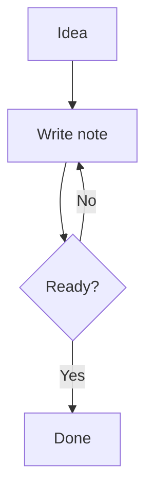
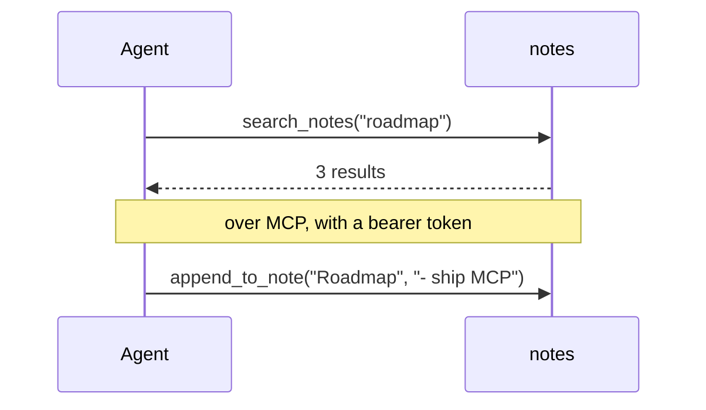

Every Markdown feature **notes** renders. Copy this file into your notes folder to try it. #demo

## Text

Plain paragraphs, **bold**, _italic_, ~~strikethrough~~, `inline code`, <kbd>Ctrl</kbd>+<kbd>K</kbd> and <mark>highlights</mark>.
A single line break is kept as a break.
Smart typography: "curly quotes", dashes -- and ellipses... Emoji shortcodes :rocket: :tada:

Links: [external](https://example.com), [[Another note]], [[Another note#Some heading|with alias]] and #tags (also #nested/tags).

## Lists

- [x] Ship the app
- [ ] Write real notes
  - Nested item
1. First
2. Second

## Table

| Feature  | Enabled | Notes          |
| -------- | :-----: | -------------- |
| Tables   |   yes   | This one       |
| Math     |   yes   | KaTeX          |
| Diagrams |   yes   | Mermaid fences |

## Alerts

> [!NOTE]
> A **note** alert. Markdown works inside.

> [!TIP]
> A tip.

> [!WARNING]
> Careful with this.

> [!CAUTION]
> Dangerous.

> A plain quote.

## Code

```ts
function greet(name: string): string {
  return `Hello, ${name}!`; // [!code highlight]
}
```

```ts
function sum(a: number, b: number) { // [!code --]
function sum(a: number, b: number): number { // [!code ++]
  return a + b;
}
```

## Math

Inline $a^2 + b^2 = c^2$, and a block:

$$
\int_0^\infty e^{-x^2}\,dx = \frac{\sqrt{\pi}}{2}
$$

## Diagram



Sequence diagrams, pies and the rest of Mermaid's types use the same look:



## Collapsible

<details>
<summary>Click to expand</summary>

Hidden content, with **markdown**.

</details>

## Media

Images, video and audio use image syntax; paste or drop files in the editor to upload them:
``, ``, ``.

## Footnotes

A footnote reference.[^1]

[^1]: The footnote, with a [link](https://example.com).
